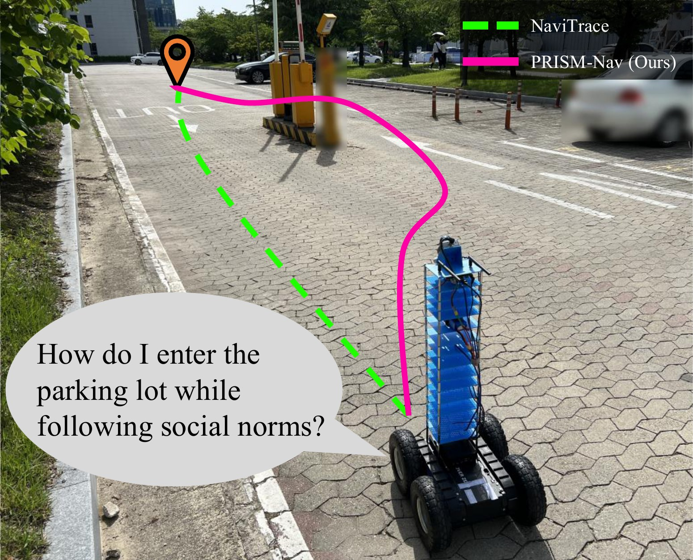
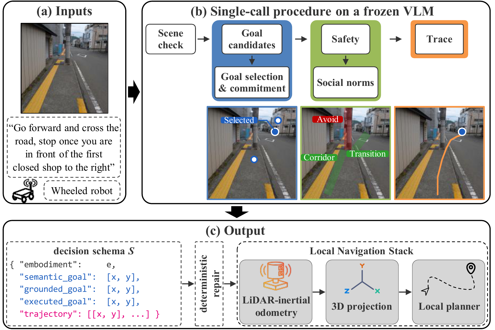

# PRISM-Nav

**A Procedural Reasoning Interface with Structured Output for Model-Agnostic Zero-Shot Navigation Trace Generation**

Anonymous Authors · under double-anonymous review

This repository hosts the project page of the paper. Open [`index.html`](index.html) in a browser to view it.

<p align="center"></p>

## Overview

A frozen vision-language model (VLM) can draw a navigation trace over a first-person image without task-specific training, but it fails in one of two ways. Some models chain points without settling a destination, which we call the *wandering trace*. Others reach an accurate trace only after long reasoning, which we call the *reasoning cost*. PRISM-Nav is a zero-shot, model-agnostic decision harness that specifies what a frozen VLM decides and in what order within one call.

- A **decision schema** bounds the waypoints and asks for the goal before the path.
- A **single-call procedure** orders the remaining decisions into six stages that may not be revised.
- A **deterministic repair** corrects the start point and the coordinate range of the output.

<p align="center"></p>

## Results at a glance

| | |
|---|---|
| Largest gain on the NaviTrace benchmark score | +79 points |
| Largest gain at equal resolution | +51 points |
| Backbone configurations higher at equal resolution (p < 0.01) | 20 of 24 |
| Latency per decision on Gemini 3 Flash | −58%, with ten points more |

The page reports the full comparison on 24 API and open-weight backbone configurations, the hidden test split, latency and price, the component ablation, the waypoint bound, and the real-robot runs.

## Contents

| Path | Content |
|---|---|
| [`index.html`](index.html) | The project page |
| [`prompts/`](prompts/README.md) | Every system prompt used in the paper, namely PRISM-Nav, the NaviTrace baseline, each ablation row, and the waypoint-bound sweep, with the user message of the benchmark |
| [`static/`](static) | Figures and styles of the page |

## Acknowledgements

The experiments use the [NaviTrace](https://github.com/leggedrobotics/navitrace_evaluation) benchmark. The page is built on the [Academic Project Page Template](https://github.com/eliahuhorwitz/Academic-project-page-template), adapted from [Nerfies](https://nerfies.github.io), and is licensed under [CC BY-SA 4.0](http://creativecommons.org/licenses/by-sa/4.0/).

## Citation

```bibtex
@article{prismnav2026,
  title   = {{PRISM-Nav}: A Procedural Reasoning Interface with Structured Output
             for Model-Agnostic Zero-Shot Navigation Trace Generation},
  author  = {Anonymous Authors},
  journal = {Under review},
  year    = {2026}
}
```
